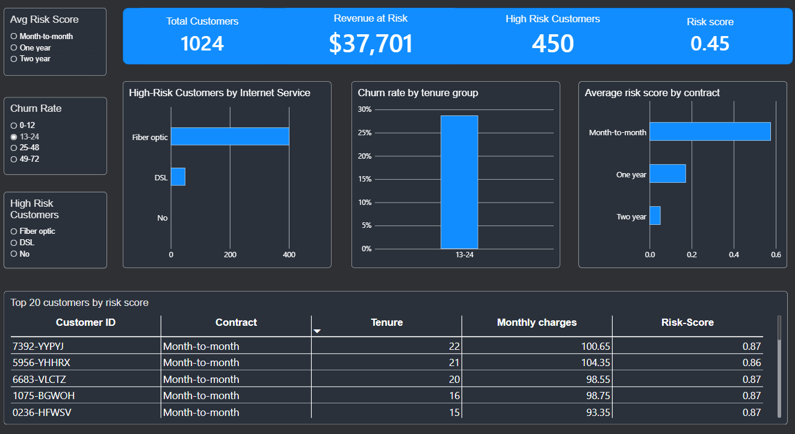

# Customer Churn Prediction

An end-to-end machine learning project that predicts whether a telecom customer is likely to churn. The project covers exploratory data analysis, feature engineering, model comparison, threshold selection, SHAP explainability, batch scoring, and an interactive Streamlit application.

## Demo

Run the Streamlit app locally and enter a customer's details to receive:

- A predicted churn probability
- A low, medium, or high risk label
- A retention-oriented interpretation of the result

```text
Customer details -> preprocessing -> XGBoost pipeline -> churn probability -> risk level
```

## Power BI Dashboard

The project also includes a Power BI dashboard for exploring customer churn patterns and prediction outputs.



The dashboard explores churn by contract type, tenure, monthly charges, payment method, and predicted risk level.

## Project Highlights

- Cleans and prepares the Telco Customer Churn dataset.
- Engineers service-count, average-spend, and tenure-group features.
- Compares Logistic Regression, Random Forest, and XGBoost.
- Uses stratified cross-validation and a held-out test set.
- Selects a classification threshold using a simple retention-value calculation.
- Saves the complete preprocessing and model pipeline with `joblib`.
- Generates batch predictions for downstream reporting.
- Includes SHAP-based model explainability in the modeling notebook.

## Repository Structure

```text
.
├── app/
│   └── streamlit_app.py          # Interactive prediction app
├── data/
│   ├── raw/
│   │   └── telco_churn.csv       # Source dataset
│   └── processed/
│       ├── telco_clean.csv       # Cleaned modeling data
│       └── predictions.csv       # Customer-level predictions
├── models/
│   ├── churn_model.joblib        # Saved fitted model pipeline
│   └── config.json               # Model name and decision threshold
├── notebooks/
│   ├── 01_eda.ipynb              # Exploratory analysis
│   └── 02_modeling.ipynb         # Training, evaluation, and SHAP
├── src/
│   ├── preprocess.py              # Shared cleaning and feature engineering
│   ├── predict.py                 # Single-customer prediction logic
│   └── export_predictions.py      # Batch scoring script
├── requirements.txt
└── LICENSE
```

## Setup

The commands below are for Windows PowerShell. Run them from the repository root.

```powershell
python -m venv .venv
.\.venv\Scripts\Activate.ps1
python -m pip install -r requirements.txt
```

If PowerShell blocks virtual-environment activation, use this for the current terminal session:

```powershell
Set-ExecutionPolicy -Scope Process -ExecutionPolicy Bypass
```

## Run the Application

```powershell
python -m streamlit run app\streamlit_app.py
```

Then open `http://localhost:8501` in a browser.

## Run the Analysis

Open the notebooks in VS Code or Jupyter and select the project virtual environment as the Python kernel.

The notebooks expect to be run from the `notebooks` directory because they use relative paths such as `../data/raw/telco_churn.csv`.

The recommended order is:

1. Run `01_eda.ipynb` to inspect and clean the raw data.
2. Run `02_modeling.ipynb` to compare models, tune the selected model, evaluate it, and save the model files.

## Run Predictions

Test the saved model with the example customer in `src/predict.py`:

```powershell
python src\predict.py
```

Generate predictions for every customer in the raw dataset:

```powershell
python src\export_predictions.py
```

The batch script writes `data/processed/predictions.csv`, which can be used for reporting or imported into a BI tool.

## Data Preparation

The shared preprocessing code:

- Converts `TotalCharges` to numeric values and fills invalid or missing values with `0`.
- Removes `customerID` from model features.
- Converts the target from `Yes`/`No` to `1`/`0`.
- Creates `num_services`, `avg_monthly_spend`, and `tenure_group`.

The same preprocessing logic is used during batch prediction and in the Streamlit application to keep training and inference consistent.

## Modeling Approach

The modeling notebook evaluates:

- Logistic Regression
- Random Forest
- XGBoost

Categorical variables are one-hot encoded and numerical variables are standardized inside a scikit-learn `Pipeline`. The data is split into 80% training and 20% test data using stratification and `random_state=42`.

The currently saved model is XGBoost. Its decision threshold is stored in `models/config.json`:

```json
{
	"model": "XGBoost",
	"threshold": 0.55
}
```

The threshold is not automatically the same as the default `0.50`. It was selected using illustrative business assumptions about customer value, offer cost, and retention success rate. These assumptions should be replaced with validated business numbers before production use.

## Explainability

The modeling notebook uses SHAP to inspect:

- Global feature importance
- How features influence churn probability
- A detailed explanation for a high-risk customer

This helps connect model output to practical retention decisions instead of treating the prediction as a black box.

## Output Fields

The batch prediction file includes:

- Customer and contract information
- Tenure and monthly charges
- Actual churn outcome
- Churn probability (`risk_score`)
- Binary prediction (`predicted_churn`)
- Risk category (`risk_level`)
- Whether the row belongs to the training or test split

## Limitations

- This is a portfolio and educational project, not a production retention system.
- The business assumptions used for threshold selection are illustrative.
- The model predicts association, not the causal effect of a retention offer.
- Model performance should be monitored on newer customer data before deployment.
- Customer identifiers are retained only in the batch output and are excluded from model features.

## Future Improvements

- Add automated tests for preprocessing and prediction behavior.
- Add model metrics and confusion-matrix results to the repository.
- Add probability calibration and threshold monitoring.
- Add data validation for incoming Streamlit inputs.
- Add a deployed demo and screenshots of the application.
- Add a versioned data and model update workflow.

## License

This project is licensed under the MIT License. See [LICENSE](LICENSE) for details.
